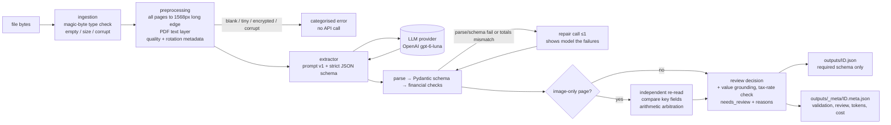

# Invoice Intelligence

An LLM-based pipeline that reads a vendor document (clean PDF, scan or phone photo), decides
whether it is an invoice, and returns **validated** JSON. It also reports how well it works,
where it fails and what it costs.

## TL;DR for reviewers

| rubric area | in one line | details |
|---|---|---|
| **Eval harness** | `python -m src.eval.run`: per-field accuracy (normalised and exact), line items matched row by row, invoice confusion matrix, per-document report with silent errors marked | [evaluation_report.md](reports/evaluation_report.md) |
| **Extraction & validation** | OpenAI `gpt-6-luna` with a strict JSON schema; **80/80 fields** on the 10 labelled documents (4 fresh runs); totals, subtotal, tax-rate and row checks; every value of a digital PDF traced to its page and printed line | [evaluation_report.md §2](reports/evaluation_report.md) |
| **Failure analysis** | the labelled set has 0 errors, so failures were studied on degraded copies: errors grouped by cause, what was fixed, what is still open (e.g. `Pomfret` → `Reefret` on blurred scans), ranked "fix first" list | [failure_analysis.md](reports/failure_analysis.md) |
| **Bad-input handling** | non-invoices (purchase order, bank statement, cover letter) all correct; corrupt, empty, encrypted and unreadable files plus API timeouts handled without crashing the batch | [§7](#7-bad-input-handling) |
| **Cost** | provider-reported tokens × published price: **$0.00045 per digital invoice, $0.00089 per scanned invoice**; whole project ≈ $0.28 | [cost_analysis.md](reports/cost_analysis.md) |
| **Code & communication** | 205 offline tests, typed, linted; works from a fresh clone; every change made after looking at results is disclosed | [docs/architecture.md](docs/architecture.md) |
| **Bonus** | `needs_review` flag measured against real errors (precision / recall per data set); web UI shows the actual validation steps and evidence | [§8](#8-human-review-flag-bonus) |

**Honest caveats:** 10 documents is a small sample (10/10 correct is consistent with as little as
69% per-document accuracy). About 1 wrong value per run still goes unflagged on degraded scans.
The prompt was not tuned on the labelled documents.

### Reading guide (for reviewers, ~10 minutes)

| question | read |
|---|---|
| Does it work, and how is it scored? | §1 below, then [reports/evaluation_report.md](reports/evaluation_report.md) (matching rules §3) |
| Why does it fail, and what would I fix first? | [reports/failure_analysis.md](reports/failure_analysis.md) §1 and §3 |
| What does it cost? | [reports/cost_analysis.md](reports/cost_analysis.md) (per document type at the top) |
| Is the review flag any good? | §8 below, [reports/experiments/review_signals.md](reports/experiments/review_signals.md) |
| What changed after the first version, and was it worth it? | [reports/remediation_report.md](reports/remediation_report.md), then [reports/improvement_report.md](reports/improvement_report.md) |
| How is the code organised? | [docs/architecture.md](docs/architecture.md) (components, data contracts, decision log) |
| Try it | §2 below, then `python -m src.main serve` |

The 10 labelled documents are **the evaluation set**. Everything named `stress_*` is a synthetic
degradation of those documents, used for **exploration only**: it is labelled as such in every
output and no generalisation is claimed from it.

---

## Contents

1. [Results at a glance](#1-results-at-a-glance)
2. [Quick start](#2-quick-start)
3. [Architecture](#3-architecture)
4. [Model and technology choices](#4-model-and-technology-choices)
5. [Prompting approach](#5-prompting-approach)
6. [Validation and failure strategy](#6-validation-and-failure-strategy)
7. [Bad-input handling](#7-bad-input-handling)
8. [Human-review flag (bonus)](#8-human-review-flag-bonus)
9. [Evaluation methodology and matching rules](#9-evaluation-methodology-and-matching-rules)
10. [Cost](#10-cost)
11. [Usage: CLI, batch, API, web UI](#11-usage)
12. [Configuration](#12-configuration)
13. [Tests and quality checks](#13-tests-and-quality-checks)
14. [Repository layout](#14-repository-layout)
15. [Limitations](#15-limitations)

---

## 1. Results at a glance

**Accuracy on the 10 labelled documents** (`python -m src.eval.run`):

| field | accuracy | correct / total |
|---|---|---|
| is_invoice | 100% | 10 / 10 |
| vendor | 100% | 10 / 10 |
| invoice_number | 100% | 10 / 10 |
| invoice_date | 100% | 10 / 10 |
| currency | 100% | 10 / 10 |
| line_items | 100% | 10 / 10 (66/66 rows exact) |
| tax_total | 100% | 10 / 10 |
| total | 100% | 10 / 10 |

Read this with care:
- **10 documents is a small sample.** 10/10 correct has a 95% confidence interval of [69%, 100%]
  per-document accuracy.
- It was **reproduced in 4 independent fresh runs** of the shipped prompt, and also held under
  every ablation (image-only, text-only, no reasoning, a different model, the token-confidence
  mode). The labelled set is too clean to separate them.
- Invoice classification on the evaluation set: 9/9 invoices and 1/1 non-invoice (confusion matrix
  in the eval output). Per-document results: [reports/eval_per_document.md](reports/eval_per_document.md).
- Failure modes were therefore measured on **degraded copies** of the labelled documents (GT
  unchanged), then fixed where the evidence supported a fix
  ([remediation_report.md](reports/remediation_report.md)):

  | set (runs) | v1 | final |
  |---|---|---|
  | "mild" phone-scan quality: field errors per run (3 runs each) | 3.00 | **1.67** |
  | "mild": correct documents wrongly flagged for review, per run | 2.00 | **0** |
  | "mild": silent (unflagged) errors per run | 1.33 | 1.00 |
  | "severe": field accuracy / flag recall | 27.5% / 100% | 27.5% / 100% |
  | rotated 90° and 270°: correct documents wrongly flagged | 18 | **0** |

  - `MAP/D/09-0312` → `MAP/09-0312` is **fixed**. Photos are now upscaled like PDF pages:
    wrong in 6/6 runs before, correct in 9/9 after.
  - `Pomfret` → `Reefret` is **not fixed** (the source is too degraded), and it is usually not
    flagged. Silent errors on degraded scans remain the main weakness.
  - On "severe" scans the model returns `null` rather than guessing, and every such document is
    flagged.

**All 20 documents** were processed into [outputs/](outputs/): 17 invoices and 3 non-invoices
(purchase order, bank statement, cover letter), 0 failures, 2 flagged for review:
- **U04:** the document itself does not add up.
- **U02:** the first read misread one amount (96.00 vs 98.00). The totals check caught it, and the
  output is left as extracted, not hand-corrected.

**Validation beyond arithmetic.** For digital PDFs, every extracted value is located in the PDF text
layer, and its page and source line are recorded. On 200 real values there were 0 false alarms, and
100% of injected invoice-number, vendor, date and description errors were caught
([error_injection.md](reports/experiments/error_injection.md)). A tax-rate check catches
"self-consistent" misreads that every other check passes.

**Cost:** **$0.00045 per digital invoice**, **$0.00089 per scanned or photographed invoice** (it
gets a second, independent read), $0.00030 per non-invoice. The whole project, including every
experiment, used about **$0.28** of API credit.

## 2. Quick start

Requirements: Python 3.11+, an OpenAI API key. Optional: Node.js, used only by the UI render tests
(they are skipped without it).

```bash
git clone <repo-url> invoice-intelligence && cd invoice-intelligence
python -m venv .venv
# Windows (PowerShell): .venv\Scripts\Activate.ps1     macOS/Linux: source .venv/bin/activate
pip install -r requirements-dev.txt
cp .env.example .env                    # Windows: copy .env.example .env ; then set OPENAI_API_KEY
pytest                                  # verifies the install: 205 offline tests, no API key needed
```

Troubleshooting:

| symptom | fix |
|---|---|
| `error [provider_auth]: OPENAI_API_KEY is not set` (CLI exit 2, API 503) | copy `.env.example` to `.env` in the repository root and put your key in it |
| `error: data/labelled not found` | the sample pack is not in `data/` (see below) |
| `provider_error ... insufficient_quota` | the OpenAI account has no credit; it is not retried on purpose |
| PowerShell refuses to run `Activate.ps1` | `Set-ExecutionPolicy -Scope CurrentUser RemoteSigned`, or call `.venv\Scripts\python.exe` directly |
| results differ from the reports | expected with `--no-cache` (LLM sampling); the cached default reproduces a run exactly |

The sample pack is confidential and is **not** in this repository. Place it in `data/`
(see [data/README.md](data/README.md)):

```
data/labelled/L01.pdf, L01.json, ... L10.pdf, L10.json
data/unlabelled/U01.pdf ... U10.pdf
```

Then:

```bash
python extract.py data/labelled/L01.pdf > out.json   # one document -> required-schema JSON
python -m src.eval.run                              # evaluation on the 10 labelled docs
python -m src.main batch                            # all 20 docs -> outputs/ (resumable)
python -m src.main serve                            # web UI + API on http://127.0.0.1:8000
pytest                                              # 205 tests, no network, no API spend
```

A fresh clone has no response cache, so `python -m src.eval.run` makes real API calls
(about 13 calls, under $0.01).

## 3. Architecture



| responsibility | module |
|---|---|
| ingestion, file validation | `src/ingestion/loader.py` |
| PDF/image preprocessing, text layer, quality heuristics | `src/preprocessing/pages.py` |
| prompt + response schema | `src/extraction/prompts.py` |
| provider abstraction, retries/backoff | `src/extraction/providers/base.py` |
| OpenAI adapter | `src/extraction/providers/openai_provider.py` |
| response cache (reproducible, free re-runs) | `src/extraction/providers/cache.py` |
| parsing of model output | `src/extraction/parsing.py` |
| extraction + validation-driven repair | `src/extraction/extractor.py` |
| schemas (required + extended) | `src/schema.py` |
| financial checks (totals, subtotal, tax lines, rows, tax rate) | `src/validation/financial.py` |
| self-consistency re-read for scans + arbitration notes (never auto-accepts) | `src/validation/consistency.py` |
| field evidence: value → page + source line in the PDF text layer | `src/validation/evidence.py` |
| token-confidence signal (opt-in) | `src/validation/confidence.py` |
| human-review decision | `src/validation/review.py` |
| end-to-end, never-raising pipeline | `src/pipeline.py` |
| cost: pricing table, per-doc rows, summaries | `src/cost/` |
| evaluation: normalisation, comparison, metrics, CLI | `src/eval/` |
| CLI / batch / API / web UI | `src/main.py`, `extract.py`, `src/api/` |

Full version with sequence diagram, data contracts and a decision log linking each choice to its
measurement: [docs/architecture.md](docs/architecture.md).

**Swapping the model.** The pipeline only depends on `LLMProvider.complete(LLMRequest) -> LLMResponse`.
A new vendor needs one adapter that maps those dataclasses to its SDK and its exceptions to
`ProviderError`, plus one branch in `src/extraction/providers/__init__.py`. The unit tests already
run the whole pipeline against a scripted fake provider through the same interface.

## 4. Model and technology choices

**Model: OpenAI `gpt-6-luna`**, reasoning effort `low`, via the Responses API. Reasons:
- It is the cheapest current (non-deprecated) OpenAI model with image input and strict
  JSON-schema structured outputs: $0.10 / $0.50 per 1M input/output tokens (checked 2026-11-19).
- Native image input means one model handles digital PDFs, scans and photos the same way.
  There is no separate OCR engine to install, tune or pay for.
- Strict structured outputs made malformed JSON a non-issue: **0 parse or schema failures in 184
  real calls**.

Alternatives I measured on the labelled set: `gpt-5-nano` (also 100%, but *more* expensive per
document here because it emitted ~450 reasoning tokens per call, and it is deprecated), and
effort `none` (100%, same cost). With no accuracy difference, `low` effort was kept as a cheap
margin for harder layouts. That is a judgement call, not a measured win.

**Input: "hybrid".** Each page is sent as an image, plus the PDF's embedded text layer when one
exists. The text layer has exact characters but scrambled reading order (in L01 the table
columns come out one value per line). The image has the layout. Measured honestly: hybrid,
image-only and text-only all scored 100% on the labelled set, so hybrid is a robustness choice,
not a measured improvement (see [evaluation_report.md §4](reports/evaluation_report.md)).

**Resolution.** Every page reaches the model with a 1568 px long edge. PDF pages are rendered at
that size, and since the remediation phase smaller photos are **upscaled** to it as well
(`UPSCALE_IMAGES`). Before that, photos were only downscaled, and the model misread small
identifiers on them. Upscaling took mild-stress L10 from wrong in 6/6 runs to correct in 9/9,
with no effect on clean documents ([remediation_report.md §2.1](reports/remediation_report.md)).

**Libraries:** PyMuPDF (fast PDF rendering + text layer, detects encryption), Pillow (image
decoding, EXIF rotation, quality heuristics), Pydantic v2 (strict validation), FastAPI (API),
argparse (CLI, no extra dependency), tabulate (terminal tables), python-dotenv.

## 5. Prompting approach

The full prompt is in [`src/extraction/prompts.py`](src/extraction/prompts.py). It was written
before any labelled result was seen. The shipped version is labelled `v3`, but its wording is
**identical to v1**: a v2 experiment added an "invoice-number occurrences" field, which was measured
to catch nothing and was removed ([remediation_report.md §2.1](reports/remediation_report.md)).

- **Classification and extraction in a single call.** The model has to read the page either way,
  so a separate classifier call would double latency for no gain.
- **Explicit decision rules** for the cases that trip extractors: issuer vs bill-to, invoice
  number vs PO / tax ID, issue date vs due date, day-first vs month-first dates from context,
  currency from symbol + country, items inside vs outside the item table, discount rows as
  negative amounts, `tax_total = 0` when no tax is shown, final payable total vs balance due.
  These encode the labelling conventions published with the sample pack, i.e. the client's
  business rules.
- **"Copy, never compute".** The model is told to transcribe printed numbers and *never* adjust
  them to make the totals add up. Arithmetic is checked in code, so a model that "fixes" a total
  would hide exactly the errors we need to see.
- **Abstention is allowed.** "A null is acceptable, a guessed value is not". The model also lists
  `illegible_fields` and `ambiguities`.
- **Evidence fields.** Besides the 8 required fields, the model returns `document_type`, printed
  subtotal, individual tax lines, per-row unit price and adjustments outside the table. These
  feed validation and the review flag, and are stripped before writing the required output.

## 6. Validation and failure strategy

Every model answer goes through three gates. Values are **never silently changed**.

1. **JSON parse** (tolerates code fences or surrounding text).
2. **Pydantic, strict mode.** Types (a `"1,200.00"` string is rejected rather than coerced),
   finite numbers, real calendar dates in `YYYY-MM-DD`, ISO 4217 currency codes, no extra
   fields, and `is_invoice = false` ⇒ all other fields `null`.
3. **Financial checks** (`src/validation/financial.py`, tolerance `AMOUNT_TOLERANCE=0.02`):
   - **required:** `sum(line_items.amount) + tax_total == total`
   - localising checks: items vs printed subtotal (missed row), tax lines vs `tax_total`
     (mis-added tax), `quantity × unit_price ≈ amount` per row (misread digit; 0.5% slack for
     rounded unit prices)
   - charges or discounts that appear **outside** the item table (shipping, round-off) make the
     required formula legitimately fail. The result is reported as `unresolved_adjustments`
     and flagged, never folded in silently.

**What happens when a check fails:**

| failure | action |
|---|---|
| transient provider error (timeout, 429, 5xx, connection) | retry with exponential backoff + jitter, max 3 retries, honours `Retry-After` |
| non-retryable provider error (auth, bad request, quota, refusal) | fail immediately with a categorised error |
| JSON parse, schema or totals mismatch | **one repair call** that shows the model the exact failures and asks it to re-read (not to force the arithmetic); the best attempt is kept, and a tie keeps the original |
| still failing after repair | parse/schema → document fails with `extraction_parse_error` / `schema_validation_error`; totals → output kept, `needs_review = true` |

Failure categories are kept distinct (`src/errors.py`): bad input (`empty_file`,
`unsupported_format`, `corrupt_file`, `encrypted_file`, `file_too_large`,
`unreadable_document`), provider (`provider_timeout`, `provider_error`, `provider_auth`,
`provider_refusal`), model output (`extraction_parse_error`, `schema_validation_error`), plus
financial status and `not_invoice`, which are outcomes rather than errors.

## 7. Bad-input handling

**Non-invoices.** The model classifies the document type. For anything that is not an invoice,
the output is `is_invoice: false` with every other field `null`. This is enforced in code even if
the model fills fields. All 3 non-invoices in the pack (purchase order, bank statement, cover
letter) were classified correctly.

**Additional scenario chosen: corrupt or unreadable files.** It is caught before any API call,
so it costs $0:

| input | detection | result |
|---|---|---|
| 0-byte file | size check | `empty_file` |
| `.pdf` that is really HTML (expired download link) | magic bytes, not extension | `corrupt_file` |
| truncated / damaged PDF | PyMuPDF open/render failure | `corrupt_file` |
| password-protected PDF | `needs_pass` | `encrypted_file` |
| unsupported type (`.docx`, `.txt`) | magic bytes | `unsupported_format` |
| blank page / tiny image | contrast and resolution heuristics | `unreadable_document` |
| too large / too many pages | `MAX_FILE_MB`, `MAX_PAGES` | `file_too_large` |
| API timeout | bounded retries, then `provider_timeout` | batch continues |

Each error carries an actionable hint ("The PDF is password-protected. Remove the password and
resubmit."). A failed document never crashes a batch: `outputs/<id>.json` gets an explicit error
object (not a fake `is_invoice: false`), the run's exit code is non-zero, and re-running the batch
retries only the failed documents. Degraded-but-readable scans are *not* rejected by heuristics.
They go to the model, which abstains on what it cannot read (measured on the severe stress set).
Rotated scans (U05) are detected and the model is told about the rotation. They are deliberately
**not** auto-rotated: direction detection was only 89.7% reliable on a 160-case test bed, and the
model read 18/18 rotated test documents correctly anyway ([remediation_report.md §3](reports/remediation_report.md)).

## 8. Human-review flag (bonus)

`needs_review` is stored in `outputs/_meta/<id>.meta.json` (the required JSON is unchanged), with
specific, actionable reasons. There is deliberately **no numeric confidence score**: an LLM's
self-reported confidence is not a calibrated probability.

Review triggers:
- totals mismatch or unresolved adjustments;
- subtotal, tax-line or row-level inconsistency;
- missing critical fields;
- model-reported ambiguities or illegible fields;
- classification conflict;
- a repair call was needed;
- a tax line that is not its printed rate × subtotal (single-rate invoices);
- for digital PDFs, any extracted value that is **not found in the PDF text layer**;
- for scans and photos, an **independent re-read that disagrees** (`VERIFY_SCANS`).

A re-read disagreement **always** goes to a human. The review reason states which read reconciles
with the printed totals, but nothing is accepted because its arithmetic is correct. A measured
case shows why: a misread digit propagated into a self-consistent subtotal and total, and was
accepted by an earlier rule. Values are never swapped between reads.

Image-quality and rotation heuristics are **not** triggers: measured, they flagged 26 correct
documents and no errors. They stay in the metadata and are passed to the model as hints.

Checked against the data ([remediation_report.md](reports/remediation_report.md),
[review_signals.md](reports/experiments/review_signals.md)):

| set | v1 precision / recall | final precision / recall |
|---|---|---|
| labelled (evaluation set) | no errors, 0 flags | no errors, 0 flags |
| mild stress (exploration, 4 runs) | 45% / 56% | **100%** / 43% |
| held-out degradation (exploration, 3 runs) | not measured | 91% / 91% |
| severe stress (exploration) | 100% / 100% | 100% / 100% |
| rotated sets (exploration) | 10% / 100% | **100%** / 100% |

The flag is precise. Its recall on mildly degraded scans is limited by **correlated errors**: in 24%
of erroneous documents both independent reads made the same mistake (e.g. `Pomfret` → `Reefret`), so
nothing that compares reads can see it. A token-confidence signal was tested for this and did not
reduce silent errors on the held-out set ([improvement_report.md §4](reports/improvement_report.md)).
It remains available as an opt-in, cheaper mode (`TOKEN_CONFIDENCE=true`, `LLM_EFFORT=none`).

## 9. Evaluation methodology and matching rules

`python -m src.eval.run` runs the full pipeline on every document in `data/labelled` that has a
`<id>.json`, then compares the output field by field. It prints the table, and writes
`reports/results.csv` (one row per document × field), `reports/eval_results.json` (predictions,
GT, line-item alignment, validation, review reasons, API metadata) and the eval cost files.
Options: `--no-cache`, `--tag NAME` (writes to `reports/experiments/NAME/`), `--input-mode`,
`--model`, `--effort`, `--repair-attempts`, `--verify-scans on|off`, `--data-dir`.

Each field gets an **exact** verdict (raw equality) and a **normalised** verdict (the headline):

- **vendor:** case, whitespace, punctuation and `&`/`and` are ignored. Legal suffixes are **not**
  (`Acme Pvt Ltd` ≠ `Acme`); a suffix-insensitive variant is shown for information only.
- **invoice_number:** case and whitespace ignored; separators and leading zeros kept.
- **invoice_date:** ISO; textual dates normalised; ambiguous numeric dates never guessed.
- **currency:** upper-cased ISO code.
- **amounts:** numeric parsing (`"1,200.00"` = `1200`), tolerance 0.01; `null` ≠ `0`.
- **line_items:** one-to-one alignment, so one missing row doesn't cascade. The field is correct
  only if counts match and every row matches on description + quantity + amount. Item precision
  and recall and per-attribute accuracies are reported separately; order is reported but not scored.

Full table and rationale: [evaluation_report.md §3](reports/evaluation_report.md).
Reproducibility: responses are cached by a hash of (model, effort, prompt, schema, exact input
bytes), so re-running the eval is free and deterministic. `--no-cache` forces fresh calls.
Ground truth is only read by the comparison step and is never modified.

## 10. Cost

Method: provider-reported tokens per call × published price (cached input at the cached rate).
Every call is included (extractions, re-reads, repairs). Details: [reports/cost_analysis.md](reports/cost_analysis.md).

| document type (final batch) | per document | no prompt-cache upper bound |
|---|---|---|
| **digital invoice** (1 call) | **$0.00045** | $0.00059 |
| **scanned / photographed invoice** (2 calls: read + independent re-read) | **$0.00089** | $0.00143 |
| non-invoice | $0.00030 | $0.00045 |
| average over all 20 | $0.00054 | $0.00078 |

Tokens: ≈ 2,200 per page image + 1,560 prompt/schema in, ~350 out (digital) to ~1,200 out (scans).
All validators added after v1 (grounding, tax-rate, arbitration) cost $0 in API calls.
At these rates, 1,000 invoices cost about $0.50–0.80. The real operating cost is human review of
flagged documents, which is why flag precision is a priority in the failure analysis.

## 11. Usage

```bash
# one document (required schema on stdout; review reasons on stderr; exit 1 if processing failed)
python extract.py invoice.pdf > out.json
python -m src.main extract invoice.jpg --full     # + validation, review, tokens, cost

# batch: data/labelled + data/unlabelled -> outputs/<id>.json, outputs/_meta/, reports/cost_*
python -m src.main batch                 # resumable: skips docs already done with the same config
python -m src.main batch --force         # reprocess everything

# evaluation
python -m src.eval.run
python scripts/make_stress_set.py --level mild && python -m src.eval.run --data-dir data/stress_mild --tag stress_mild
python scripts/summarize_experiments.py  # reports/experiments/summary.md + total API spend

# API + web UI
python -m src.main serve                 # http://127.0.0.1:8000
curl -F "file=@invoice.pdf" http://127.0.0.1:8000/extract
```

`POST /extract` returns `{"result": <required schema>, "metadata": {status, needs_review,
review_reasons, error, financial_check, auxiliary_extraction, consistency_check, usage, ...}}`.
Problems with the *document* (corrupt, non-invoice, provider outage) are reported in a normal
200 response, because the UI must display them. HTTP errors are only for bad requests
(missing file → 422, too large → 413). `GET /health` reports the configured provider and model.

The web UI (`GET /`) shows the uploaded document next to:
- the extracted fields and line items;
- a reconciliation panel (items + tax = computed vs printed total);
- the **validation workflow** that actually ran (schema, totals, row/tax checks, evidence, re-read,
  token confidence, then the decision);
- a **field-evidence table** (where each value is printed: page + source line);
- the independent-re-read comparison, review reasons, the required JSON (copyable), and token/cost
  information.

Example output (`outputs/L07.json`; the discount is a negative line item):

```json
{
  "is_invoice": true,
  "vendor": "PIXEL HARBOR STUDIO",
  "invoice_number": "PHS-1042",
  "invoice_date": "2026-03-14",
  "currency": "USD",
  "line_items": [
    {"description": "Brand identity package", "quantity": 1.0, "amount": 3200.0},
    {"description": "Social media templates (set of 12)", "quantity": 1.0, "amount": 850.0},
    {"description": "Additional revision rounds", "quantity": 3.0, "amount": 450.0},
    {"description": "Returning client discount (10%)", "quantity": null, "amount": -450.0}
  ],
  "tax_total": 334.13,
  "total": 4384.13
}
```

## 12. Configuration

All settings are environment variables (see [.env.example](.env.example)). Only `OPENAI_API_KEY`
is required. Commonly changed: `LLM_MODEL` (default `gpt-6-luna`), `LLM_EFFORT` (`low`),
`INPUT_MODE` (`hybrid` | `image` | `text`), `VERIFY_SCANS` (`true`), `UPSCALE_IMAGES` (`true`), `AMOUNT_TOLERANCE` (`0.02`),
`LLM_MAX_RETRIES` (`3`), `LLM_MAX_REPAIR_ATTEMPTS` (`1`), `LLM_TIMEOUT_S` (`90`),
`MAX_IMAGE_EDGE_PX` (`1568`), `LLM_USE_CACHE` (`true`), `TOKEN_CONFIDENCE` (`false`; needs
`LLM_EFFORT=none`), `CONFIDENCE_THRESHOLD` (`0.5`).

Secrets: `.env` is git-ignored and no key appears in the code. Requests are sent with
`store=false`, so OpenAI does not keep response state for these confidential documents.

## 13. Tests and quality checks

```bash
pytest                         # 205 tests, ~7 s, fully offline (scripted fake provider)
ruff check . && ruff format --check .
mypy                           # src/, strict-ish settings in pyproject.toml
```

Covered: digital, scanned and photo ingestion; magic-byte detection; empty, corrupt, encrypted,
oversized, blank and tiny inputs; rotation detection; schema validation (dates, currency, string
amounts, NaN, extra or missing fields, non-invoice nulls); financial checks (tolerance boundary,
discounts, charges outside the table, round-off, row and tax-line checks); repair loop and its
limit; malformed JSON; timeouts, retry limits, backoff and `Retry-After`; auth errors not retried;
OpenAI adapter request mapping, usage parsing, refusals, truncation and error mapping; strict-schema
compatibility; response cache; consistency check and arbitration; value grounding (page/source,
number formats, whole-token identifiers, derived tax); tax-rate check; token-confidence span mapping;
eval normalisation, line-item alignment, metrics, confusion matrix; cost formulas and per-type
summaries; API endpoints; CLI exit codes; batch resumability; UI render functions (executed in Node
against real pipeline metadata).

`tests/test_failure_handling.py` runs HTTP 429/500, timeouts, retry exhaustion, malformed JSON,
invalid or missing fields and financial mismatches end to end through the **real OpenAI adapter**
with a fake SDK client. It checks exact call counts, backoff delays (1 s, 2 s, 4 s), error
categories and review behaviour. A mutation check (loosening the retry bound by one) makes 5 tests fail.

Real end-to-end runs (not unit tests) are recorded in `reports/`: the official eval, the
experiment and regression runs under `reports/experiments/`, and the 20-document batch.

## 14. Repository layout

```
src/
  ingestion/loader.py          file type detection, early rejection
  preprocessing/pages.py       rendering, text layer, quality/rotation heuristics
  extraction/                  prompts, parsing, extractor (repair loop), providers/ (base, openai, cache)
  validation/                  financial (+ tax rate), evidence (grounding), consistency, confidence, review
  eval/                        normalize, compare, metrics, run (python -m src.eval.run)
  cost/                        pricing table, per-document cost rows and summaries
  api/                         FastAPI app + static web UI
  schema.py, pipeline.py, runner.py, config.py, errors.py, main.py
extract.py                     python extract.py invoice.pdf
scripts/                       stress sets, error injection, experiment summaries, review-signal analysis
docs/architecture.md           components, sequence, data contracts, decision log
tests/                         205 offline tests
outputs/                       <id>.json for all 20 documents, _meta/ (processing metadata), _manifest.json
reports/                       evaluation_report.md, eval_per_document.md, failure_analysis.md,
                               cost_analysis.md, remediation_report.md, improvement_report.md,
                               results.csv, eval_results.json, cost_*.csv/json, experiments/
data/                          (not committed) the confidential sample pack
```

`outputs/` and `reports/` contain values extracted from the sample documents, and `reports/`
contains ground-truth excerpts for the failure analysis. The brief asks for both, but **keep the
repository private** and share it only with the reviewers.

## 15. Limitations

- **Small, clean evaluation set.** 10 documents, all legible, so 100% has a wide confidence
  interval and cannot rank configurations. Robustness numbers come from synthetic degradation,
  which is not the same as real phone photos (glare, folds, handwriting, perspective).
- **Untested by the labelled data:** ambiguous day/month dates, discounts or charges outside the
  item table, multi-currency documents, credit notes, multi-invoice PDFs, long (>10 page) invoices.
  The code handles several of these (`unresolved_adjustments`, `MAX_PAGES`), but there is no
  accuracy evidence for them.
- **Silent misreads on degraded scans remain** (about 1 per mild-stress run, e.g. `Pomfret` →
  `Reefret`, identical in both reads and produced with token probability ≈ 1, so neither the re-read
  nor token confidence catches it). Upscaling cut total errors on mild stress from 3.0 to 1.7 per
  run, but not the silent ones.
- **Value grounding only works for digital PDFs** (scans have no text layer), and it cannot detect
  day/month swaps of numeric dates, which render identically.
- **`outputs/U02.json` contains one misread amount** (96.00; the image shows 98.00). It is flagged
  for review. The output was not corrected by hand.
- **The repair loop fired once** in ~400 real calls (U02) and did not fix the error. Its benefit
  is unmeasured.
- Every re-read disagreement goes to a human, including ones the arithmetic could have
  settled. This trades some review effort for never auto-accepting a wrong value.
- Several rules were refined after a measurement (listed in
  [improvement_report.md §6](reports/improvement_report.md)), so some exploration-set numbers are
  in-sample. The evaluation set was never used to tune a rule.
- The required schema cannot represent shipping or round-off outside the item table. Such
  invoices are flagged rather than reconciled.
- LLM output is not bit-for-bit deterministic. The response cache makes re-runs reproducible,
  but a `--no-cache` run can differ, especially on degraded scans (see the stress-test repeats).
- Prices and model availability change. `src/cost/pricing.py` records the date they were checked.
