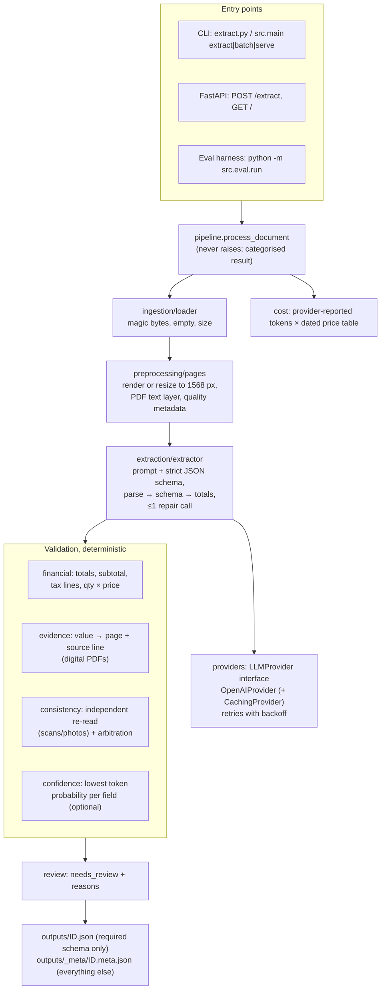
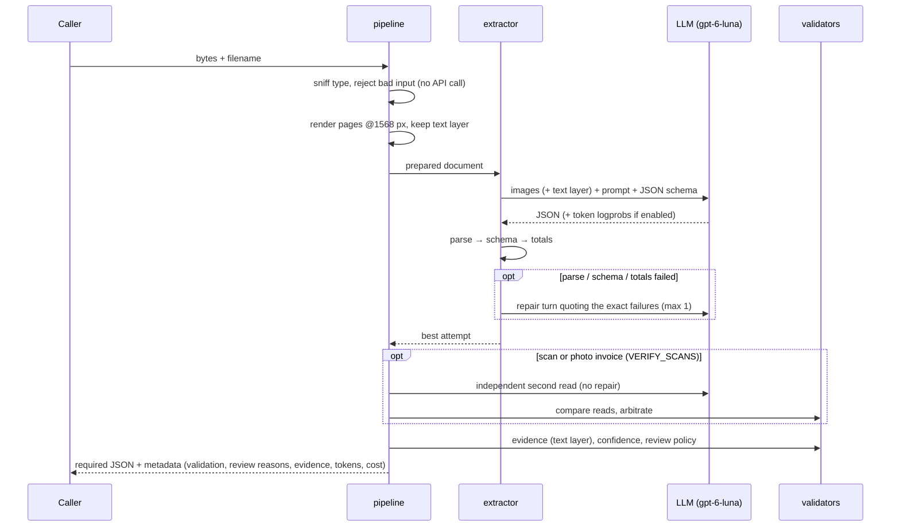

# Architecture

How one document flows through the system, what each module guarantees, and why each design
choice was made (with links to the measurement behind it).

## 1. Components

| module | guarantees |
|---|---|
| `ingestion/loader.py` | detects the real file type from magic bytes; rejects empty, oversized, unsupported or disguised files **before any API call** |
| `preprocessing/pages.py` | every page reaches the model at a 1568 px long edge; PDF text layer kept per page; blank/tiny pages rejected; quality metrics recorded as metadata only |
| `extraction/prompts.py` | one versioned prompt; JSON schema = 8 required fields + evidence fields used for validation |
| `extraction/extractor.py` | parse → Pydantic → financial checks; at most one repair call; keeps the best attempt (ties keep the first) |
| `extraction/providers/` | provider-neutral request/response; the only place retries happen (bounded, exponential backoff, `Retry-After`); cache keyed by a hash of the exact request |
| `validation/financial.py` | arithmetic checks; never changes a value |
| `validation/evidence.py` | locates each extracted value in the PDF text layer (page, source line); evidence comes from string search, never from the model |
| `validation/consistency.py` | compares two independent reads of a scan; types each disagreement; arbitration never accepts on arithmetic alone and never swaps values |
| `validation/confidence.py` | maps output-token probabilities onto JSON values; formatting-only tokens excluded |
| `validation/review.py` | turns signals into explicit, human-readable review reasons; no numeric "confidence score" |
| `pipeline.py` | turns every outcome (success, non-invoice, bad input, provider outage, bad model output, bug) into a `PipelineResult` |
| `eval/` | normalisation, one-to-one line-item alignment, field / document / classification / review-flag metrics |
| `cost/` | per-call cost from provider-reported usage; per-document and per-document-type summaries |

## 2. One document, step by step

## 3. Data contracts

| artifact | content | guaranteed by |
|---|---|---|
| `outputs/<id>.json` | exactly the 8 required fields, or an explicit `{"error": ...}` object for a failed document | `InvoiceExtraction` (strict Pydantic) |
| `outputs/_meta/<id>.meta.json` | status, needs_review + reasons, error, financial check, evidence, consistency check, token confidence, auxiliary extraction, attempts with usage, cost, config | `PipelineResult.metadata_json` |
| `reports/eval_results.json` | everything above plus GT, per-field verdicts and line-item alignment, for every labelled document | `src/eval/run.py` |

The required schema is never extended: evidence, confidence and review data live only in the
metadata.

## 4. Decision log

| decision | alternative rejected | evidence |
|---|---|---|
| vision LLM, no separate OCR engine | OCR + text LLM | one model for digital, scanned and photographed pages; 0 schema failures in hundreds of calls with strict outputs |
| `gpt-6-luna`, effort `low` | `gpt-5-nano`, effort `none` | all score 100% on the clean set; gpt-5-nano cost more per document (reasoning tokens) ([evaluation_report §4](../reports/evaluation_report.md)) |
| hybrid input (image + text layer) | image-only, text-only | no measured accuracy difference; kept for layout robustness, disclosed as unproven |
| photos upscaled to 1568 px | downscale-only | L10 identifier misread: wrong 6/6 runs → correct 9/9 ([remediation_report §2.1](../reports/remediation_report.md)) |
| second independent read for scans | single read | only signal catching *uncertain* text misreads on scans |
| no auto-rotation | heuristic rotation | direction detection 89.7%; model read 18/18 rotated test pages correctly ([remediation_report §3](../reports/remediation_report.md)) |
| image-quality heuristics informational only | review triggers | 0 true positives, 26 false flags |
| invoice-number "occurrences" field | kept in prompt | removed: 0 true positives, +12% cost |
| value grounding in the text layer | model-reported evidence | deterministic, cannot be hallucinated; 0 false positives on 12 digital invoices, catches injected text errors ([improvement_report](../reports/improvement_report.md)) |
| arbitration needs arithmetic **and** token confidence | arithmetic alone | a value can add up and still be wrong; arithmetic alone is not accepted as proof |

## 5. Extension points

- **New LLM provider:** implement `LLMProvider.complete()` (map `LLMRequest` to the SDK and its
  exceptions to `ProviderError`), add a branch in `providers/__init__.py`. Retries, cache, cost and
  validation work unchanged.
- **New validator:** a pure function from the extraction (and optionally the prepared document) to
  a list of reason strings, passed to `decide_review`. Add it to `metadata_json` if reviewers need
  its detail.
- **New document type:** extend `DocumentType` and the classification rules in the prompt; the
  required output for non-invoices stays all-null.
